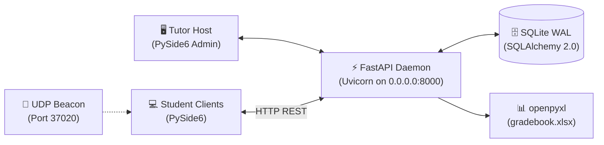

# 🎓 Offline LAN University Quiz Platform

A cross-platform (**Windows & Linux**) desktop quiz platform in **Python 3.11+** and **PySide6 (Qt 6)** designed for university computer labs on an offline Local Area Network (LAN). 

It features dual-role workflows (**Tutor Host Server** and **Student Lab Client**) and automatically syncs graded quiz results into a structured Excel gradebook (`gradebook.xlsx`).

---

## ⚡ Key Features

* **Zero-Config LAN Discovery:** Host broadcasts over UDP (`port 37020`); student clients auto-discover the server with manual IP/Port fallback.
* **Concurrency-Hardened Backend:** Embedded **FastAPI** + **SQLite in WAL mode** (`busy_timeout=5000ms`), tested for 40+ simultaneous student submissions.
* **Anti-Cheating & Integrity:** Deterministic per-student question/option shuffling; answers excluded from client payloads; server-enforced timer (5s grace).
* **Dual-Layer Auto-Save:** Drafts backed up locally (`recovery/attempt_*.json`) and synced to the server every 10 seconds.
* **Hybrid Grading:** Instant auto-grading for MCQ and True/False; manual review queue for Short-Answer questions.
* **Live Excel Sync:** Non-destructive `openpyxl` engine that inserts new quiz columns, preserves existing marks, and maintains dynamic `=SUM(...)` formulas in `data/gradebook.xlsx`.

---

## 🏗 Architecture



---

## 🚀 Quick Start

### 1. Installation

```bash
cd lan_quiz_platform

# Create & activate virtual environment
python3 -m venv .venv
source .venv/bin/activate       # On Windows: .venv\Scripts\Activate.ps1

# Install dependencies
pip install -r requirements.txt
```

### 2. Run the App

```bash
python main.py
```

* **Tutor Mode:** Starts server on port `8000` + UDP beacon. Displays the generated **Tutor Access Code** (also stored in `data/tutor_access_code.txt`) needed for tutor registration.
* **Student Mode:** Auto-discovers the host IP via UDP (or enter manual IP:Port), register/login with university email (`@nmu.edu.eg`), and take active quizzes.

---

## 🧪 Testing & Verification

Run the test suite to verify hybrid grading, Excel formula preservation, and concurrent load:

```bash
pytest tests/ -v
```

* `tests/test_grading_and_excel.py`: MCQ/TF auto-scoring, short-answer review workflow, and Excel sync.
* `tests/test_concurrency.py`: 30 concurrent student submissions and simultaneous draft saves under SQLite WAL mode.

---

## ⚙️ Configuration Reference

Key settings in [`shared/config.py`](file:///mnt/Omar/Codding/UniQuizPlat/lan_quiz_platform/shared/config.py):

| Setting | Default | Description |
|---|---|---|
| `SERVER_PORT` | `8000` | HTTP REST API port |
| `UDP_BROADCAST_PORT` | `37020` | UDP beacon discovery port |
| `EMAIL_DOMAIN_SUFFIX` | `@nmu.edu.eg` | University domain validation |
| `STUDENT_ID_REGEX` | `r"(\d{6,12})"` | Auto-extracts student ID from email |
| `TIMER_GRACE_SECONDS`| `5` | Grace buffer before auto-lock |
| `AUTO_SAVE_INTERVAL_SECONDS` | `10` | Auto-save & draft sync frequency |

---

## 📁 Project Structure

```text
lan_quiz_platform/
├── main.py                     # App entry point (Launcher)
├── requirements.txt            # Python dependencies
├── data/                       # DB, Excel gradebook, and recovery drafts
├── shared/                     # Config and Pydantic DTO schemas
├── server/                     # FastAPI app, SQLite models, auth, UDP, Excel sync
│   └── routers/                # Auth, quiz, attempt, and grading endpoints
├── client/                     # PySide6 GUI, API client, QSS stylesheet
│   └── windows/                # Launcher, Auth, Tutor, and Student windows
└── tests/                      # Concurrency and grading test suites
```
